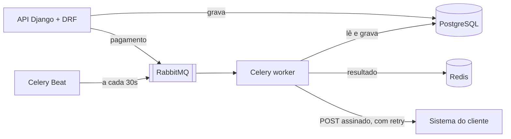

# cobranca-pix

API de cobranças em Django que gera o QR Code Pix (BR Code estático) e um PDF de cobrança, marca sozinha as cobranças vencidas e avisa o sistema do cliente por webhook, com nova tentativa quando o cliente está fora do ar.

É um projeto de estudo: não fala com banco nenhum. O "Pix copia e cola" segue o padrão do Banco Central e é aceito por apps de banco, mas a confirmação de pagamento é simulada por um endpoint.

## O que ele faz

1. O lojista cria uma cobrança pela API (`POST /api/charges/`) e recebe de volta o código Pix copia e cola.
2. `GET /api/charges/{id}/qrcode/` devolve o QR Code em SVG; `GET /api/charges/{id}/pdf/` devolve um PDF com os dados e o QR Code.
3. A cada 30 segundos o Celery Beat agenda a tarefa que procura cobranças pendentes com vencimento no passado, marca como vencidas e cria um aviso de webhook para cada uma.
4. Um worker do Celery envia o webhook assinado com HMAC. Se o cliente responder erro ou não responder, ele tenta de novo em 10s, 20s, 40s... até 5 vezes; depois disso marca como falha, e dá para reenviar pelo admin.
5. `POST /api/charges/{id}/pay/` simula a confirmação do banco e dispara o webhook `charge.paid`. `POST /api/charges/{id}/cancel/` cancela.



## Stack

| Peça | Papel aqui |
|---|---|
| Django 6 | Models, migrations, admin |
| Django REST Framework | Serializers, ViewSet, autenticação por token, permissões |
| PostgreSQL 17 | Banco, com check constraint e índice parcial |
| Celery 5 | Tarefas em segundo plano: job de vencidas e envio de webhook |
| RabbitMQ 4 | Broker: a fila por onde as tarefas chegam ao worker |
| Redis 7 | Backend de resultados do Celery |
| segno e fpdf2 | QR Code e PDF, ambos sem dependência de sistema |
| pytest-django, Ruff | Testes com cobertura mínima de 90% e lint |
| Docker Compose, GitHub Actions | Stack local e CI |

## Como rodar

Com Docker (sobe API, worker, beat, Postgres, RabbitMQ, Redis e um recebedor de webhook de demonstração):

```bash
docker compose up -d --build --wait
docker compose exec web python manage.py seed_demo
```

O `seed_demo` imprime um token e cria duas cobranças, uma já vencida. Em até 30 segundos o beat marca essa como vencida e o webhook sai. O recebedor de demonstração responde 503 nas duas primeiras chamadas, para mostrar o retry:

```bash
docker compose logs -f webhook-receiver worker
```

Chamando a API:

```bash
TOKEN=<token impresso pelo seed_demo>
curl -H "Authorization: Token $TOKEN" http://localhost:8000/api/charges/
curl -H "Authorization: Token $TOKEN" -H "Content-Type: application/json" \
  -d '{"amount": "49.90", "description": "Assinatura", "payer_name": "Ana", "payer_document": "12345678901", "due_date": "2030-01-10", "webhook_url": "http://webhook-receiver:8001/hook"}' \
  http://localhost:8000/api/charges/
```

- Admin do Django: <http://localhost:8000/admin/> (crie o usuário com `docker compose exec web python manage.py createsuperuser`).
- Painel do RabbitMQ: <http://localhost:15672/> (guest/guest), para ver as filas.

Sem Docker, só para os testes (usa SQLite e roda as tarefas do Celery na hora, sem broker):

```bash
uv sync
uv run pytest
uv run ruff check .
```

## Endpoints

| Método e caminho | O que faz |
|---|---|
| `POST /api/token/` | Troca usuário e senha por um token |
| `GET /api/charges/?status=pending` | Lista as cobranças do usuário, paginadas, com filtro opcional |
| `POST /api/charges/` | Cria cobrança; devolve `pix_copia_e_cola` |
| `GET /api/charges/{id}/` | Detalhe |
| `POST /api/charges/{id}/pay/` | Simula o pagamento; 409 se a cobrança está paga ou cancelada |
| `POST /api/charges/{id}/cancel/` | Cancela; 409 se já está paga |
| `GET /api/charges/{id}/qrcode/` | QR Code em SVG |
| `GET /api/charges/{id}/pdf/` | PDF da cobrança |
| `GET /api/health/` | Verifica a API e o banco, sem autenticação |

O webhook chega como `POST` com JSON `{"event": "charge.overdue" | "charge.paid", "delivery_id": ..., "charge": {...}}` e o cabeçalho `X-Signature-SHA256`, que é o HMAC-SHA256 do corpo com o `WEBHOOK_SECRET`.

## Decisões técnicas

- **Pix montado à mão, testado contra o exemplo oficial.** O BR Code é uma sequência de campos TLV com um CRC16 no fim. O primeiro teste compara o resultado com o exemplo do manual do Banco Central, caractere por caractere ([charges/pix.py](charges/pix.py)).
- **Estado muda só por ação.** O serializer não deixa o cliente escrever `status`; ele muda por `pay` e `cancel`, que validam a transição no model e devolvem 409 Conflict quando ela não vale. Cobrança não é apagada (`DELETE` dá 405), porque some o histórico financeiro.
- **Dono filtrado duas vezes.** O queryset só traz as cobranças do usuário (cobrança de outro dá 404, sem revelar que existe) e a permissão `IsChargeOwner` confere de novo no objeto, para o caso de alguém mudar o queryset no futuro.
- **Regras no banco, não só no Python.** `CHECK (amount > 0)` e `UNIQUE (charge, event)` no Postgres: o segundo impede notificar a mesma vencida duas vezes mesmo se o job rodar em dobro.
- **Índice parcial para o job de vencidas.** O job procura `status = 'pending' AND due_date < hoje`. O índice cobre só as pendentes, que são poucas perto do histórico de pagas, então fica pequeno e rápido. Outro índice cobre a listagem por dono e data.
- **Job seguro com mais de um worker.** `SELECT ... FOR UPDATE SKIP LOCKED`: dois workers rodando juntos pegam linhas diferentes em vez de travar um ao outro.
- **Fila só depois do commit.** O pagamento enfileira o webhook com `transaction.on_commit`; sem isso o worker pode buscar a entrega antes de ela existir no banco.
- **Retry com espera crescente.** 10s, 20s, 40s, 80s, 160s. Cada tentativa fica registrada (`attempts`, `response_status`, `last_error`) e aparece no admin. `acks_late` faz a mensagem só sair da fila depois que a tarefa termina, então um worker que cai no meio não perde o aviso.
- **RabbitMQ de broker, Redis de resultado.** O RabbitMQ garante a entrega e confirmação de cada mensagem; o Redis guarda o resultado das tarefas, que é dado descartável.
- **Testes sem mock de biblioteca.** O envio HTTP real é testado contra um servidor HTTP local de verdade. O resto usa um `FakeWebhookSender` em memória, injetado por configuração (`WEBHOOK_SENDER_FACTORY`), e o Celery em modo que executa a tarefa na hora.
- **CI do barato pro caro.** Lint, depois testes no Postgres, depois a stack inteira no Docker conferindo que o webhook da cobrança vencida chega depois de um retry. Cada etapa só roda se a anterior passou.

## O que ficou de fora

- Integração com um provedor Pix real (Pix dinâmico, cobrança com `txid` registrada no PSP, webhook de pagamento do banco).
- Boleto registrado, com linha digitável e código de barras.
- Autenticação por OAuth ou chave por lojista; aqui é token simples do DRF.
